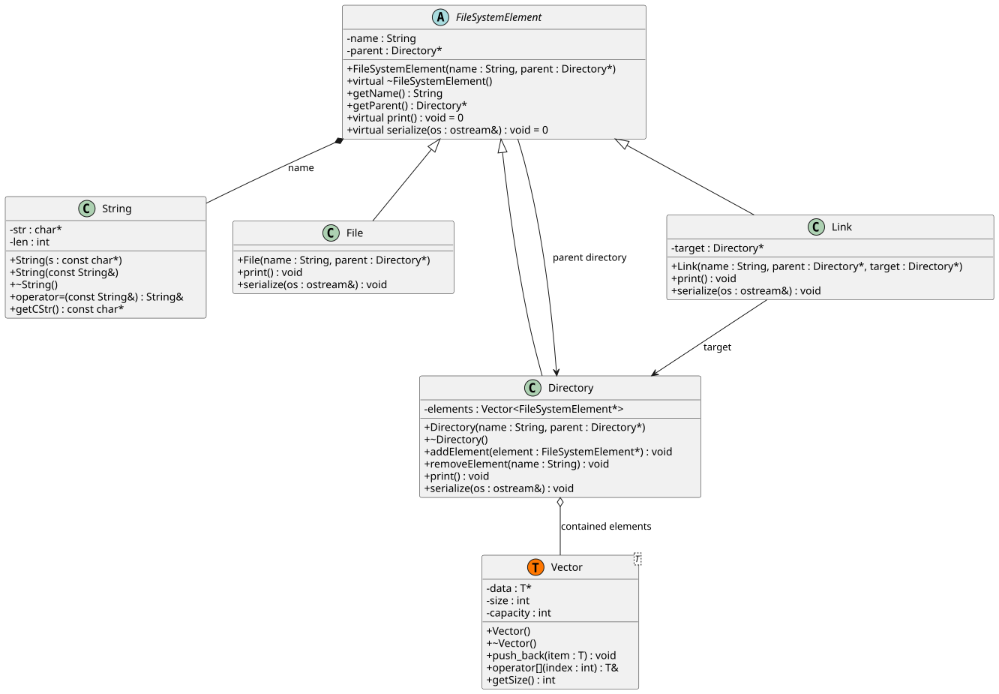

# unix-fs-sim

A C++ implementation of a hierarchical filesystem simulator. It manages files, directories, and symbolic links in memory with a custom serialization engine for state persistence.

## Features

- **Standard Navigation**: Supports absolute and relative path resolution (including `..`).
- **File Operations**: Implements `mkdir`, `touch`, `ls`, `rm`, `cd`, `ln`, and `mv`.
- **Memory Management**: Recursive cleanup of directory structures to prevent memory leaks.
- **Persistence**: Automated state serialization to and from `filesystem.dat`.
- **I/O Redirection**: Standard streams are fully redirectable for batch processing.

## Implementation Details

The project is designed with zero external dependencies to ensure portability and minimal runtime overhead.

### Custom Data Structures
To comply with specific technical constraints, no STL containers are used. The following structures are implemented from scratch:
- **`Vector<T>`**: A generic, dynamically resizing array.
- **`String`**: A memory-managed character array for path and name storage.

### Class Hierarchy
The system uses a polymorphic model based on a common interface:
- `FileSystemElement`: Abstract base class for all filesystem nodes.
- `Directory`: Container node for managing collections of elements.
- `File`: Terminal data unit.
- `Link`: Reference node for directory-level cross-linking.

## Persistence Format (`filesystem.dat`)

The filesystem state is saved as a depth-first, recursive text encoding. There are four record types:

| Tag | Format | Description |
|-----|--------|-------------|
| `D` | `D <id> <name>` | Opens a directory block; children follow |
| `END` | `END` | Closes the preceding `D` block |
| `F` | `F <name>` | File leaf (no closing tag) |
| `L` | `L <name> <target_id>` | Link leaf; `target_id` references a directory by index |

### Directory IDs

Before saving, all directories are collected into a flat list via depth-first traversal. Each directory's position in that list becomes its `<id>`. Links store their target's `<id>` as `<target_id>`, allowing the pointer to be restored after loading.

### Example

For the structure:
```
root/
  sub/
    deep/
  file1
  mylink -> sub
```

The file looks like:
```
D 0 root
D 1 sub
D 2 deep
END
END
F file1
L mylink 1
END
```

### Loading

The loader parses recursively and pushes each new directory into a list in parse order. Since this follows the same depth-first order as saving, each directory lands at the same index as its saved `<id>`. After the full tree is built, a second pass resolves each link's `target_id` to the correct directory pointer. The `<id>` field in `D` records is a human-readable label only — the loader relies entirely on insertion order.

## Usage

### Building the Project

```bash
g++ -o fs_sim src/*.cpp
```

## Architecture Visualization

The system's class structure follows a strict inheritance hierarchy to ensure type safety and polymorphic behavior across different filesystem entries.

